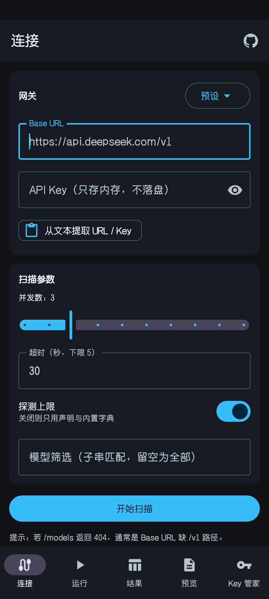
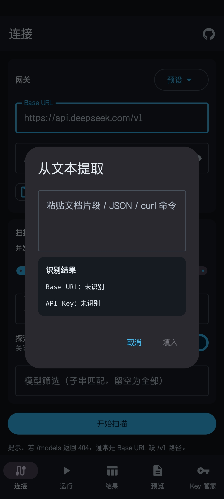
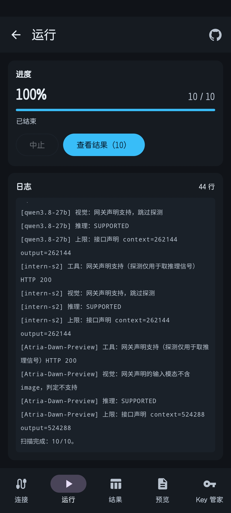
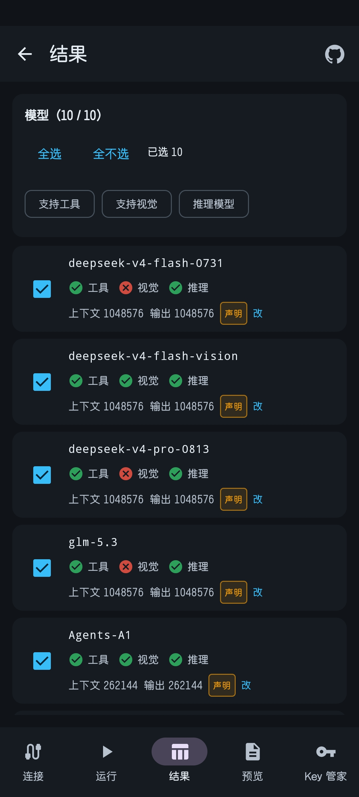
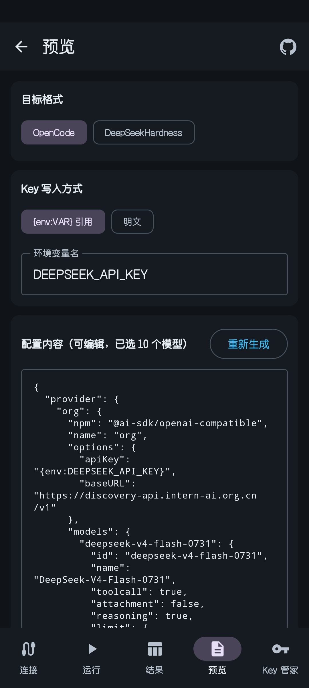

  
  <h1>ModelScout Mobile</h1>
  
大语言模型 API 能力探测与配置生成工具（Android）

连接 OpenAI 兼容的 API 服务，批量检测模型的工具调用、图片输入、推理能力及 Token 限制，
并根据检测结果生成 OpenCode、DeepSeekHardness 配置文件。

  

  
  
  
  
  

## 项目简介

本项目提供**桌面版**与**移动版**两个版本，功能一致，本仓库为移动版（Android）；桌面版见 [ModelScout Desktop](https://github.com/Huaxidesu/ModelScout-Desktop)。

使用大模型 API 时，不同模型支持的功能和参数限制可能有所不同。例如，部分模型支持图片输入或工具调用，不同模型能够处理的文本长度也存在差异。这些信息通常需要查阅服务商文档，或通过实际请求确认。

ModelScout 会获取 API 服务中的模型列表，批量检测各模型支持的功能及参数限制，并根据检测结果生成 OpenCode、DeepSeekHardness 等工具所需的配置文件，减少手动查询、测试和配置的工作量。

主要功能：

- **获取模型列表**：填写 API 地址和密钥，获取服务中可用的模型。
- **检测模型能力**：识别模型是否支持图片输入、工具调用及推理功能。
- **查询参数限制**：获取模型的上下文窗口和最大输出长度。
- **批量探测**：同时检测多个模型，实时显示进度与日志。
- **生成配置文件**：选择需要使用的模型，生成对应工具的配置文件，支持复制和保存。
- **手动调整结果**：对无法自动识别或存在偏差的参数进行修改。
- **Key 管家**（测试功能）：管理多个平台的 API Key，检测有效性与余额，记录余额变化。

## 使用方法

### 1. 配置 API 连接

在「连接」页填写 API Base URL 和 API Key。应用内置若干服务商的预设地址，可从「预设」菜单选择。

API Key 仅保存在运行内存中，不写入本地存储。

  
  

如果手头只有一段包含连接信息的文本（服务商提供的配置示例、已有配置文件、curl 命令等），可以使用「从文本提取 URL / Key」，应用会从中识别 API 地址和密钥。

在「扫描参数」中可以调整并发数、超时时间，以及是否启用上限探测。模型筛选支持子串匹配，留空表示检测全部模型。

### 2. 执行模型探测

点击「开始扫描」，应用会获取模型列表，并对选中的模型执行能力与参数检测。

探测过程中可以查看进度和日志，也可以随时中止。

默认并发数为 3。遇到 HTTP 429 错误时，建议将并发数降至 1–2。

  

### 3. 查看与调整结果

「结果」页列出每个模型的检测结果，包括工具调用、图片输入、推理能力的支持情况，以及上下文窗口和最大输出长度。

  

参数限制后会标注来源：

| 来源 | 说明 |
|---|---|
| 声明 | 由 API 服务的模型列表接口直接提供 |
| 字典 | 来自应用内置的模型参数字典 |
| 实测 | 通过实际请求探测得到 |
| 手动 | 由使用者手动填写 |
对于未能自动识别或需要调整的参数，可以点击对应条目的「改」进行修改。

### 4. 生成配置文件

在「预览」页选择目标工具和 Key 写入方式，应用会按所选模型的检测结果生成配置文件。

  

配置内容可以直接编辑，也可以重新生成。生成结果支持复制到剪贴板或保存为文件。

「Key 写入方式」建议选择 `{env:VAR} 引用`，这样生成的配置中只写环境变量名，不含密钥原文，可以安全地分享或提交到仓库。

## 探测能力

| 探测项目 | 说明 |
|---|---|
| 工具调用 | 检测 API 对工具调用请求的支持情况 |
| 图片输入 | 检测 API 对图片输入请求的支持情况 |
| 推理能力 | 根据模型名称、接口声明及响应特征识别推理模型 |
| 上下文窗口 | 查询模型支持的上下文 Token 上限 |
| 最大输出 | 查询单次响应允许的最大输出 Token 数 |

探测结果由接口声明、模型参数字典、测试请求及服务端响应综合判断。由于不同服务商的接口实现存在差异，部分能力或参数可能无法识别，此时会标记为「未知」。

详细说明参见 [探测原理与限制](../../wiki/探测原理与限制)。

## Key 管家

> **测试功能。** 「Key 管家」处于测试阶段，尚未经过完整测试，功能与行为可能发生变化，应用内标题栏带有 `BETA` 标识。
>
> 其中各平台的余额查询按公开接口文档实现，**部分平台尚未使用真实可用的 Key 完整验证**，检测结果仅供参考。

「Key 管家」用于集中管理多个平台的 API Key。

- 根据前缀识别 Key 所属平台，识别不确定时标记为「推断」。
- 检测 Key 的有效性与余额，余额变化以折线图记录。
- 状态分为可用、余额不足、已失效、查询失败四种；尚未检测的显示为待检测。
- 支持按平台分组、按状态或添加时间排序，以及按状态和平台筛选。
- 可选择将 Key 列表与历史记录加密保存在本机；该选项默认关闭，关闭时数据仅存在于本次运行中。

支持自动检测的平台、余额解析方式及安全说明参见 [Key 管家](../../wiki/Key管家)。

## 常见问题

### 探测结果与官方文档不一致

不同服务商可能对模型参数、能力支持及接口进行调整。探测结果反映的是接口的实际行为，具体限制以实际使用的 API 服务为准。

### 部分参数显示为「未知」

当 API 服务未返回可解析的参数限制时，相应字段会标记为「未知」。可参考服务商文档，点击「改」手动填写。

### 探测过程中出现 HTTP 429 错误

HTTP 429 表示请求受到服务端速率限制。可降低并发数，或在限制解除后重新执行探测。

### 生成的配置无法正常使用

目标工具的配置结构及字段要求可能随版本变化。建议确认工具版本，并核对生成的配置内容。

详细说明参见 [配置生成说明](../../wiki/配置生成说明)。

更多信息参见 [常见问题](../../wiki/常见问题)。

## 开发文档

项目使用 Kotlin 与 Jetpack Compose 开发，最低支持 Android 8.0（API 26）。

- **探测引擎**：负责模型列表获取、能力探测、并发调度与结果整理。
- **Key 管家**：独立模块，负责 Key 识别、有效性检测、余额查询与加密存储。
- **数据安全**：API Key 仅在运行期间使用；仅当启用本地保存时，Key 列表与历史记录才会加密写入应用私有目录。

源码构建、项目结构、测试方式及技术实现参见 [开发指南](../../wiki/开发指南)。

## 许可证

本项目采用 [PolyForm Noncommercial 1.0.0](LICENSE.md) 许可证。

允许在许可证规定的非商业范围内使用、修改和分发本项目。商业用途需要取得额外授权。

完整许可条款参见 [LICENSE](LICENSE.md)。
